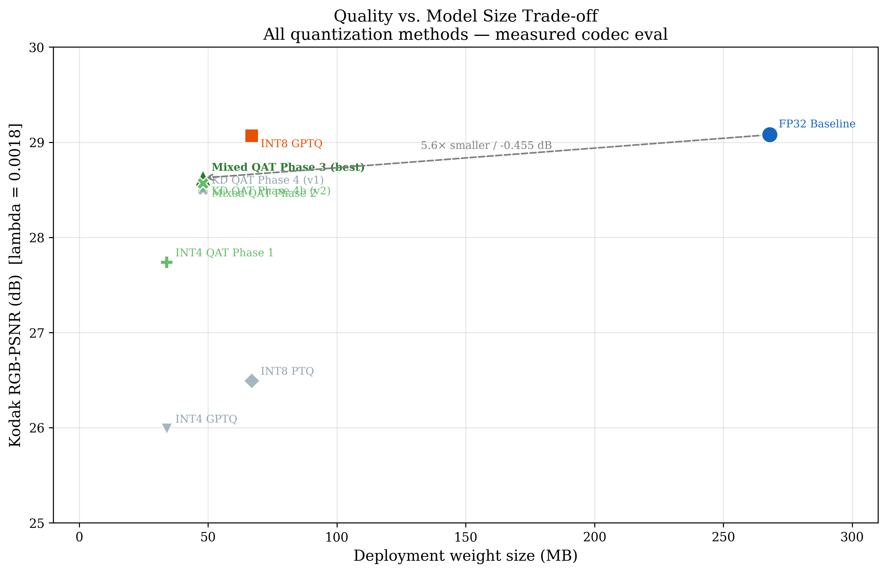

# Optimization of a Low-Complexity Learned Image Codec

### Quantization of LoC-LIC for Edge Deployment

**M.Sc. Thesis — Mohamed Sroor**
Friedrich-Alexander-Universität Erlangen-Nürnberg (FAU), LMS Chair
Supervisor: Prof. Dr.-Ing. André Kaup

---

## Overview

This repository extends [LoC-LIC](https://arxiv.org/abs/2502.10567) (Ameen et al., 2025), a 69.9M-parameter learned image codec, with post-training and training-aware quantization to reduce the 268 MB FP32 model to a deployable size without significant quality loss.

The base model code (`models/`, `modules/`, `utils/`, `loss/`, `datasets/`) is from the original LoC-LIC paper. All quantization work lives in `Optimization/`.

### Key Results

| Method | PSNR (Kodak) | Delta PSNR | Deploy Size | Training Cost |
|---|---|---|---|---|
| FP32 Baseline | 29.079 dB | -- | 268 MB | -- |
| **INT8 GPTQ** | **29.068 dB** | **-0.011 dB** | **67 MB** | minutes |
| INT8 PTQ (naive) | 26.493 dB | -2.586 dB | 67 MB | minutes |
| INT4 GPTQ | 25.991 dB | -3.088 dB | 34 MB | minutes |
| INT4 QAT Phase 1 | 27.737 dB | -1.342 dB | 34 MB | ~55 GPU-h |
| **Mixed INT8/INT4 QAT Phase 3** | **28.624 dB** | **-0.455 dB** | **48 MB** | ~110 GPU-h |
| KD QAT Phase 4 | 28.569 dB | -0.510 dB | 48 MB | ~220 GPU-h |

All metrics at lambda = 0.0018 on the Kodak dataset (24 images).



*Figure: PSNR vs. deployment weight size for all quantization methods (Kodak, λ=0.0018). This is the author's own evaluation-harness result, generated by `Optimization/generate_thesis_figures.py` — not a figure from the original LoC-LIC paper.*

---

## Repository Structure

```
.
├── models/                          # LoC-LIC model definition
├── modules/                         # Transforms, layers, entropy modules
├── loss/                            # Rate-distortion and perceptual losses
├── utils/                           # Metrics, config, logging, helpers
├── datasets/                        # Dataset loaders and CSV scripts
├── configs/                         # Model and training configs (YAML)
├── scripts/                         # Training and testing entry points
├── benchmark/                       # Backbone benchmark scripts
├── assets/                          # Figures from original LoC-LIC paper
│   ├── results/                     # Author's own result figures (this thesis)
│   └── app_screenshot.png           # Windows app screenshot (add your own)
│
├── Optimization/                    # === Quantization work (this thesis) ===
│   ├── 8-bit/
│   │   ├── 8-bit PTQ/              # Naive round-to-nearest INT8
│   │   └── 8-bit GPTQ/             # Hessian-guided INT8 (near-lossless)
│   ├── 4-bit/
│   │   ├── 4-bit PTQ/              # Naive INT4 PTQ (Brevitas)
│   │   ├── 4-bit GPTQ/             # Hessian-guided INT4
│   │   ├── 4-bit QAT/              # Uniform INT4 QAT (Phase 1)
│   │   ├── 4-bit Mixed-Precision/  # Mixed INT8/INT4 QAT (Phases 2-3)
│   │   └── 4-bit Knowledge-Distillation/  # Feature-level KD (Phase 4)
│   ├── Evaluation Harness/          # Unified eval across all 9 model variants
│   ├── Lic Container Format/        # Custom .lic bitstream container
│   ├── Windows Desktop App/         # PyQt6 GUI for compress/decompress
│   ├── eval_all_models.py           # Quick eval of FP32 + PTQ + GPTQ models
│   ├── generate_plots.py            # Reproduce thesis R-D and comparison plots
│   ├── generate_qualitative_figures.py
│   ├── generate_thesis_figures.py
│   ├── per_image_psnr.py
│   └── plot_psnr_boxplot.py
│
└── requirements.txt
```

---

## Base Model (LoC-LIC)

The `models/`, `modules/`, `utils/`, `loss/`, `datasets/`, `scripts/`, and `configs/` directories contain the original LoC-LIC architecture and training code. LoC-LIC is a low-complexity learned image codec that achieves competitive R-D performance with significantly reduced decoding complexity compared to prior work (ELIC, MLIC++).

Key components:
- **Analysis / Synthesis transforms** (`modules/transform/`) -- encoder and decoder neural networks
- **Entropy model** (`modules/transform/entropy.py`) -- hyperprior + local/global context for probability estimation
- **Checkerboard coding** (`utils/ckbd.py`) -- two-pass spatial context for parallel decoding
- **Rate-distortion loss** (`loss/rd_loss.py`) -- joint optimization of bitrate and distortion

---

## Quantization Pipeline (Optimization/)

The quantization work follows a progressive pipeline:

### Post-Training Quantization (no retraining)
- **INT8 PTQ** (`8-bit/8-bit PTQ/`) -- per-channel weight quantize-dequantize, baseline approach
- **INT8 GPTQ** (`8-bit/8-bit GPTQ/`) -- Hessian-guided rounding (Frantar et al., 2022), achieves near-lossless compression to 67 MB
- **INT4 PTQ** (`4-bit/4-bit PTQ/`) -- 4-bit variant using Brevitas
- **INT4 GPTQ** (`4-bit/4-bit GPTQ/`) -- 4-bit Hessian-guided, larger quality gap than INT8

### Quantization-Aware Training (retraining with fake-quantization)
- **Phase 1** (`4-bit/4-bit QAT/`) -- uniform INT4 QAT with STE, fine-tunes from FP32 checkpoint
- **Phase 2-3** (`4-bit/4-bit Mixed-Precision/`) -- per-layer sensitivity analysis assigns INT4 or INT8 per layer; Phase 3 achieves best quality at 48 MB
- **Phase 4** (`4-bit/4-bit Knowledge-Distillation/`) -- feature-level KD from FP32 teacher, marginal improvement over Phase 3

### Evaluation and Visualization
- **Evaluation Harness** (`Evaluation Harness/`) -- measures PSNR, SSIM, MS-SSIM, LPIPS, BPP, encode/decode time, VRAM, GMACs across all models
- **Plot scripts** -- reproduce all thesis figures from evaluation CSVs

### Desktop Application
- **Windows Desktop App** (`Windows Desktop App/`) -- PyQt6 GUI for interactive compress/decompress with model selection, side-by-side comparison, and .lic file export
- Encode latency reduced from 427 ms to 203 ms per image (FP32 → INT8 GPTQ, full `compress()` pipeline incl. entropy coding, measured on an NVIDIA RTX 3080; see `Optimization/generate_plots.py`)


### Container Format
- **LIC format** (`Lic Container Format/`) -- lightweight binary container (.lic) for storing compressed bitstreams with metadata and CRC32 validation

---

## Setup

```bash
conda create -n loclic python=3.10
conda activate loclic
pip install -r requirements.txt
```

Key dependencies: PyTorch, CompressAI, torchvision, lpips, accelerate. See `requirements.txt` for the full list.

---

## Configuration

This repo was developed on a university HPC cluster; all cluster-specific absolute paths have been replaced with neutral placeholders (`path/to/...`) or environment-variable fallbacks. Set the following before running a script:

- **`configs/general/general.yaml`** -- edit `main_path`, `dataset`, `checkpoint`, `output_dir` to your local paths.
- **`launch_distributed.sh`** -- set the `MAIN_PATH` and `DATASET` environment variables (or edit the placeholders directly), e.g. `MAIN_PATH=/path/to/workspace DATASET=/path/to/dataset/images ./launch_distributed.sh`.
- **Evaluation / figure scripts** (`Optimization/eval_all_models.py`, `Optimization/Evaluation Harness/evaluate_all.py`, `Optimization/per_image_psnr.py`, Windows Desktop App `export_onnx.py` / `benchmark_onnx.py` / `benchmark_pipeline.py`) -- pass `--test_dataset_kodak`, `--test_dataset_pro2020`, `--calib`, or `--images` on the command line, or set `LOCLIC_KODAK_DIR` / `LOCLIC_PRO2020_DIR`.
- **`Optimization/generate_thesis_figures.py`** -- infers the repo root automatically; set `LOCLIC_REPO` to override.
- **QAT / KD training scripts** (`train_qat_4bit.py`, `train_qat_mixed.py`, `train_kd.py`) -- pass `--dataset /path/to/dataset/images`.
- **`Optimization/4-bit/4-bit Mixed-Precision/layer_bits.json`** -- update the `checkpoint` and `images_dir` fields to your local paths (the per-layer bit assignments are unaffected).

---

## Checkpoints

Model checkpoints are not stored in this repository (4 GB total). The FP32 pretrained weights are from the [original LoC-LIC paper](https://arxiv.org/abs/2502.10567).

---

## Citation

```bibtex
@mastersthesis{sroor2026quantization,
  author  = {Mohamed Sroor},
  title   = {Optimization of a Low-Complexity Learned Image Codec},
  school  = {Friedrich-Alexander-Universität Erlangen-Nürnberg},
  year    = {2026},
  type    = {M.Sc. Thesis}
}
```

Base model:

```bibtex
@article{ameen2025loclic,
  title  = {LoC-LIC: Low-Complexity Learned Image Compression},
  author = {Ameen et al.},
  year   = {2025}
}
```

---

## License

See [LICENSE](LICENSE). The base LoC-LIC model code retains its original license.
